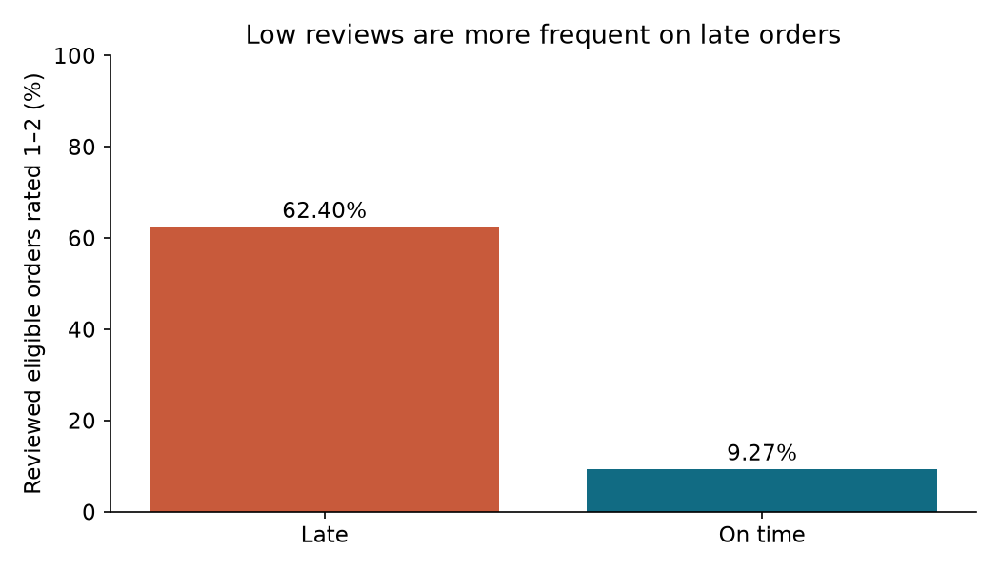

# E-commerce Delivery Performance and Customer Experience Analytics

**Where are delivery problems concentrated, how are they associated with customer satisfaction, and which orders should operations prioritise?**

A portfolio project using **historical Brazilian Olist commercial data from 2016–2018**: 99,441 orders linked to items, customers, sellers, payments, products and reviews. All monetary values are **BRL**, not AUD. Findings do not represent current Australian market conditions.

## Findings
- **6.77% late delivery:** 6,534 late orders from 96,470 eligible delivered orders.
- **RJ combines volume and an elevated rate:** 1,495 late orders, 12.11%, versus 6.77% overall. SP has 1,820 late orders but a lower 4.49% rate. Together they account for 50.73% of late orders.
- **Reviews differ sharply:** reviewed late orders have a 62.40% low-review rate versus 9.27% on time; mean scores are 2.27 versus 4.29. This is association, not a causal estimate.
- **Volume matters alongside rate:** audio has an 11.78% late rate (41/348), whereas bed_bath_table has 689 late orders from 9,272 eligible orders (7.43%). Seller/category order counts overlap.
- **Prioritisation has a workload cost:** the validation-selected logistic model finds 124 of 599 late orders by investigating 1,255 test orders, approximately 10.12 investigations per late order found. Recall is 20.70%; most flagged orders arrive on time.



## Commercial baseline
| Delivered-order metric | Result |
|---|---:|
| Orders | 96,478 |
| Merchandise value | BRL 13,221,498.11 |
| Freight, separate | BRL 2,198,275.64 |
| Average order value | BRL 137.04 |
| Mean elapsed delivery duration | 12.56 days |

January–August delivered orders increased from 21,998 in 2017 to 52,783 in 2018 (139.94%); merchandise increased 141.13%. August 2018 is incomplete and dataset coverage may change; no whole-market growth claim is made. Sparse 2016 records and extraction-boundary zero months require caution.

## Open the deliverables
- [Full analysis and recommendations](docs/analysis.md)
- [Business Analyst case study](docs/business_case.md) and [two-page PDF](docs/business_case.pdf): five requirements, acceptance criteria, assumed processes and recommendations
- [Executed prediction notebook](notebooks/late_delivery_prediction.ipynb)
- [Power BI project](powerbi/Olist.pbip) and [opening / acceptance instructions](powerbi/README.md)
- [Data relationship diagram](docs/relationship_diagram.md), [quality log](docs/data_quality_log.md), [SQL validation evidence](docs/sql_validation_results.md)
- [Five-minute walkthrough and application summary](docs/walkthrough.md)
- [Exact completion status and remaining checks](docs/completion_status.md)

**Status:** analysis and models have run successfully; five saved MySQL exports reconcile to Python. The three-page Power BI source passes public JSON schemas, but **Desktop refresh, DAX/interaction testing and screenshots are not verified** because the Computer Use runtime could not start. No live deployment, recording, measured business improvement or GitHub publication is claimed.

## Reproduce locally
Use Python 3.11+ and MySQL 8+ for SQL. Core analysis was executed with pandas 3.0.3 and scikit-learn 1.7.1.

1. Download the [Olist dataset from Kaggle](https://www.kaggle.com/datasets/olistbr/brazilian-ecommerce). Preserve original filenames in `data/raw/`; the nine CSVs are excluded from Git.
2. From this project folder run:

```powershell
python -m pip install -r requirements.txt
python python/profile_data.py
python python/build_analysis.py
python python/train_models.py
python python/create_notebook.py
python python/build_powerbi.py
python python/package_project.py
python python/build_business_case_pdf.py
python python/verify_project.py
```

The notebook executes its model comparison again so its saved outputs are reproducible. No script needs credentials except the optional MySQL importer, which prompts privately. Generated order-level data stay local. Summary CSVs and charts are reproducible; the notebook retains bounded outputs for review.

For MySQL, run `python python/import_mysql.py` against a **new** database, then select it in Workbench and execute `sql/02_reporting_views.sql`, `sql/03_validation.sql`, and `sql/04_business_analysis.sql`. The importer refuses an existing database. The owner already ran the original SQL; the monthly query now includes a calendar spine and requires rerunning to verify that revision in MySQL.

For Power BI, open `powerbi/Olist.pbip` and refresh. CSV paths are generated for this checkout; rerun `build_powerbi.py` after moving the project. Use its README to verify filters, eligible counts, suppressed small sellers and reconciled totals before saving a PBIX or taking screenshots.

## Metric dictionary
| Metric | Definition and scope |
|---|---|
| Merchandise value | Sum item prices for delivered orders; selected item/category/seller scope; freight separate |
| AOV | Merchandise value / distinct delivered orders containing those selected items |
| Late-delivery rate | Delivered orders with actual calendar date after estimated date / delivered orders with both dates |
| Delivery duration | Elapsed purchase-to-delivery seconds / 86,400; nonnegative delivered durations only |
| Low-review rate | Selected valid reviews scored 1–2 / selected valid reviewed orders; delivered scope in the report |
| Review selection | Latest creation date, latest answer timestamp, greatest review ID; score descending only as deterministic fallback, with no conflicting winning score ties found |
| Repeat customer | customer_unique_id; customer_id is order-specific |
| Seller comparison | Minimum 100 eligible orders after filters; show denominator and whole-order attribution limitation |

Dates remain source-local, with no unsupported timezone conversion. Items, payments and reviews are aggregated/selected before order-grain joins. Payment totals are separate from merchandise value. Eight delivered orders lack actual delivery dates; they remain in commercial counts and leave the late-rate denominator. No delivered orders lack items; one lacks payment and 646 lack reviews. Missing reviews are not imputed. Unmapped categories remain visible. Raw geolocation is not joined because ZIP prefixes repeat.

## Prediction design and limitations
Predict at **approval**, using the explicit whitelist in `python/train_models.py`: price/freight, item and seller counts, product size/weight, customer and representative seller state/category, approval time and promised window. Snapshot attributes being available and unchanged then are documented assumptions. Actual delivery dates are used only for labels and chronology checks; reviews, carrier dates and future aggregates are excluded from model features.

Train before January 2018 (41,183 orders), validate January–June 2018 (38,622), test July–August 2018 (12,545). Training/validation labels unavailable at the next period boundary are purged. Selection uses validation average precision, not test performance. Test AP: logistic regression 0.0917, gradient boosting 0.0799, constant baseline 0.0477. PR-AUC here means sklearn average precision.

A frozen validation threshold flags 31.95% of test orders despite approximately 10% in validation. Capacity scenarios (5%, 10%, 20%) are separate, predetermined historical simulations. The baseline budget result is random-ranking expectation, not an observed model ranking. Only delivered, observable labels are evaluated; cancellations, unresolved orders, unequal follow-up and time drift limit generalisation. No causal or financial benefits are claimed.

## Repository map
```text
data/raw/             Original Kaggle CSVs (ignored)
data/processed/       Regenerated facts, dimensions, summaries and simulations (ignored)
sql/                  MySQL reporting, validation, 12 queries; owner's five CSV exports
python/               Profiling, import, analysis, modelling and packaging
notebooks/            Executed model comparison
powerbi/              PBIP/PBIR, model, DAX, schemas and acceptance instructions
docs/                 Analysis, figures, BA case study, evidence and walkthrough
```

Recommendations: investigate RJ routes/promises (then BA), pilot proactive communication, and trial capacity-limited triage with monitoring. Stakeholder needs, processes and staff capacity are **case-study assumptions**, not interview findings.

Source attribution: [Olist Brazilian E-commerce Public Dataset](https://www.kaggle.com/datasets/olistbr/brazilian-ecommerce). Raw data are not redistributed; consult the source terms before redistribution. No repository-wide licence is asserted over third-party data or Microsoft schema files.
