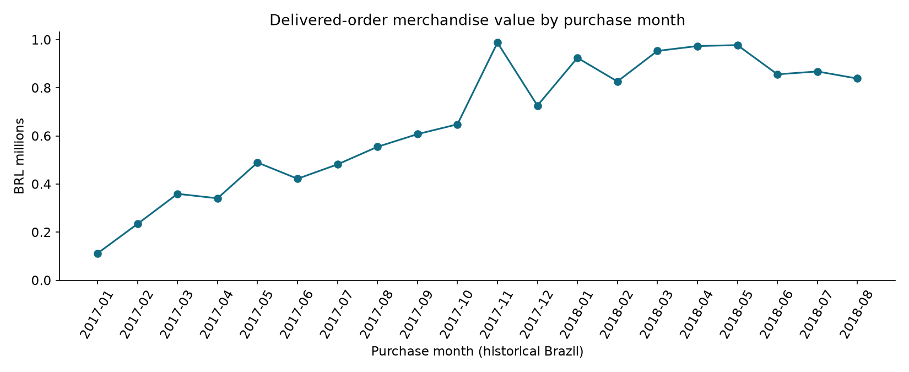
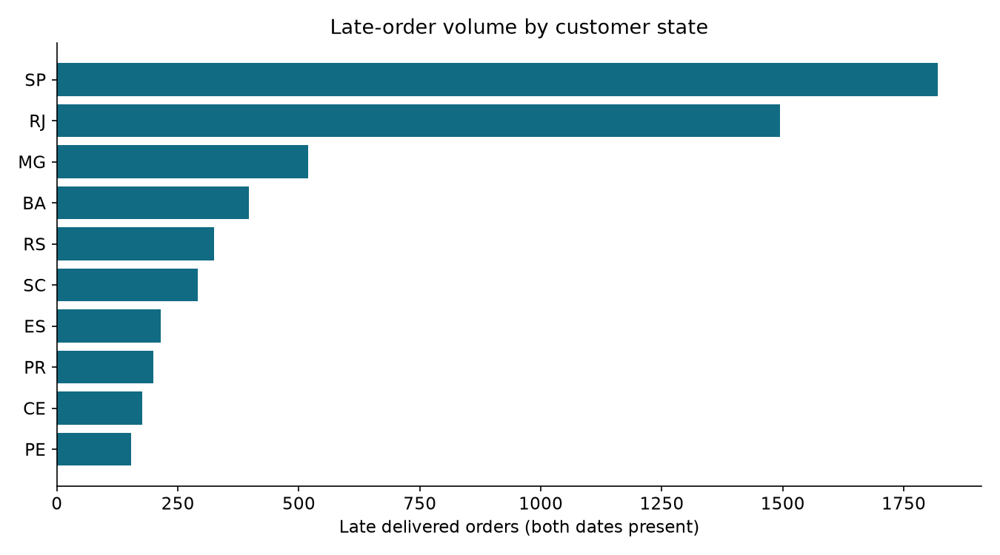
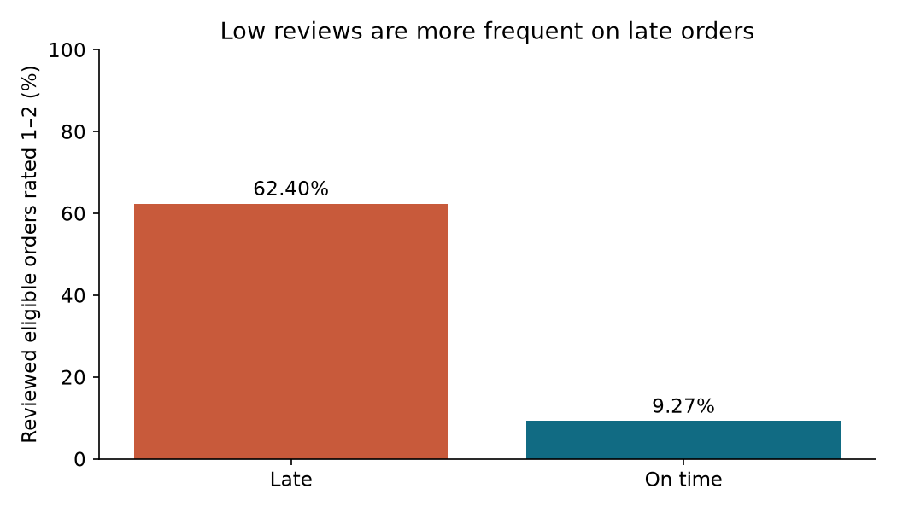
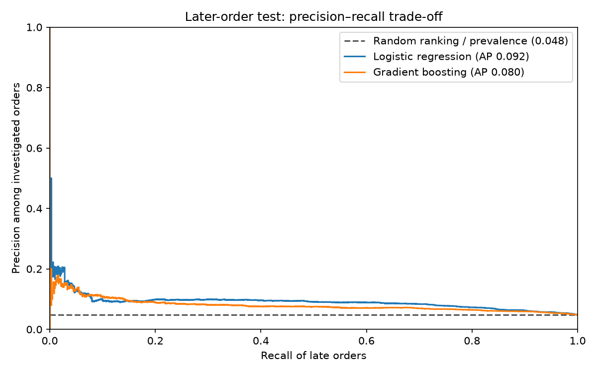

# E-commerce Delivery Performance and Customer Experience Analytics
Prepared 19 November 2026 · Historical Brazilian Olist commercial data, 2016–2018 · BRL

## Executive Summary
Rio de Janeiro combines substantial delivery problems with an elevated late rate: 1,495 late orders from 12,350 eligible orders (12.11%), compared with 6.77% overall. São Paulo has the largest late count (1,820) but a lower rate (4.49%); prioritise workload and poor relative performance separately. Together these states contain 50.73% of all late orders. [1]

Among reviewed eligible orders, 62.40% of late orders received a score of 1–2 versus 9.27% of on-time orders. This association supports investigating delivery performance, but it does not establish how much a delivery intervention would improve reviews. [2]

An approval-time model improves prioritisation modestly: investigating 1,255 test orders finds 124 late deliveries, about 10.12 investigations per late order. It captures only 20.70% of test late deliveries and its fixed threshold suffers workload drift. Treat it as a historical experiment requiring further validation. [3]

## Commercial volume grew, but the extraction boundaries matter
Delivered orders generated BRL 13,221,498.11 in merchandise, plus BRL 2,198,275.64 in freight. Merchandise AOV is BRL 137.04 across 96,478 delivered orders. Merchandise value is not accounting revenue or profit. [4]

For January–August, delivered-order count increased from 21,998 in 2017 to 52,783 in 2018 (139.94%). Merchandise value increased from BRL 2,993,456.13 to BRL 7,218,125.12 (141.13%). These equal calendar windows reduce seasonal mismatch, but the dataset cannot establish that growth represents the whole marketplace. August 2018 ends on the 29th for delivered purchases, so the latest period is incomplete. Sparse 2016 records and zero delivered purchases in September–October 2018 are extraction/coverage limitations, not evidence of a business collapse. [4]

November 2017 was the highest observed delivered-order month (7,289 orders; BRL 987,765.37 merchandise). This is an observed peak; the data alone does not identify its cause. Mean delivered-order purchase-to-delivery duration is 12.56 days. [4]

## Where operations should investigate
| Customer state | Eligible orders | Late orders | Late rate | Implication |
|---|---:|---:|---:|---|
| SP | 40,494 | 1,820 | 4.49% | High investigation volume despite below-overall rate |
| RJ | 12,350 | 1,495 | 12.11% | High volume and elevated rate |
| MG | 11,354 | 519 | 4.57% | Volume exists; rate below overall |
| BA | 3,256 | 396 | 12.16% | Additional high-rate regional investigation |
| AL | 397 | 85 | 21.41% | High rate with much lower volume |

RJ has approximately 659 more late orders than the arithmetic benchmark obtained by applying the overall rate to its eligible volume. That is a descriptive comparison, not a preventable-delay forecast: route length, seller mix, promise windows and purchase month differ. [1]

Among categories with at least 100 eligible orders, audio has the highest late rate (41/348, 11.78%). In contrast, bed_bath_table has 689 late orders from 9,272 eligible orders (7.43%), and health_beauty has 649 from 8,647 (7.51%). The higher-volume categories can justify more investigation than a small category ranked first by rate. Category groups overlap at the order level; do not add their late counts. [5]

The highest-rate qualifying seller has 74 late orders from 389 eligible orders (19.02%). There are 210 sellers meeting the 100-order threshold overall. Seller comparisons must recalculate eligibility after filters, and order-level delays cannot identify which seller caused a problem on multi-seller orders. [5]

## Delivery and customer reviews are strongly associated
| Outcome | Reviewed / eligible orders | Review coverage | Mean score / 5 | Low-review rate |
|---|---:|---:|---:|---:|
| On time | 89,443 / 89,936 | 99.45% | 4.29 | 9.27% |
| Late | 6,381 / 6,534 | 97.66% | 2.27 | 62.40% |

The low-review gap is 53.14 percentage points using unrounded values (53.13 points from displayed rounded rates), approximately 6.73 times the on-time rate. Review response coverage differs. In addition, 8,127 delivered orders have selected review creation dates before actual delivery; these outcomes must not all be described as post-delivery feedback. Latest-review selection can reflect later updates. These are associations among observed reviewed orders, not causal effects. [2]

## Approval-time prioritisation: useful ranking, limited precision
Training uses earlier approvals and only labels available before validation starts; validation labels must be available before July testing. No actual delivery, review or carrier outcomes enter the explicit feature list. Product/location/price snapshot availability at approval is an assumption, because the source has no attribute histories. [3]

| Model | Test average precision | Precision at frozen threshold | Recall at frozen threshold |
|---|---:|---:|---:|
| Prevalence baseline | 0.0477 | 0.00% | 0.00% |
| Logistic regression | 0.0917 | 8.91% | 59.60% |
| Gradient boosting | 0.0799 | 7.69% | 42.24% |

The baseline always predicts the training prevalence. At a 0.5 cutoff it flags no orders; its test AP is the test late prevalence, 4.77%. Logistic regression was selected on validation AP (0.1922 versus 0.1860 for gradient boosting), before reviewing test performance. [3]

For the chosen model at a predeclared 10% test budget: investigate 1,255 orders, find 124 late orders, precision 9.88%, recall 20.70%. Random selection at the same budget would identify approximately 60 late orders in expectation, requiring 20.94 investigations per late order. Investigations are not prevented delays. [3]

The validation-selected threshold flags 4,008 test orders (31.95%), versus approximately 10% in validation. Precision is 8.91%; 357 of 599 late orders are identified. A fixed top-k queue controls staffing load better in this simulation, but the score is not established as a calibrated probability. The dataset contains delivered outcomes only for this model, so results exclude unresolved and cancelled orders and may suffer cohort observation bias. [3]

## Three recommendations
1. **Investigate RJ first, with BA as a secondary regional case.** Compare promise windows and seller/customer routes within purchase months; distinguish late carrier handoff from transit delays before selecting a remedy. Use late rate and late count together, with staffing capacity agreed by actual stakeholders.
2. **Pilot proactive communication for delayed or high-risk orders.** The review gap supports testing this intervention, not assuming it works. Compare eligible pilot/control orders on low-review rate, contacts per order and actual late rate, preserving review-response coverage and avoiding promises of measured savings.
3. **Trial a capacity-limited approval-time investigation queue.** Start with a documented budget rather than the unstable fixed threshold. Monitor precision, recall, investigations per late order, geographic burden and workload; require a later validation period before deployment or claims of operational benefit.

Stakeholders, staffing budgets and proposed processes are case-study assumptions; no interviews or live operational intervention were conducted.

## Sources and reproducibility
1. [Region results](../data/processed/regions.csv), generated from order-grain data; SQL Query 10 reconciled with saved owner export.
2. [Review comparison](../data/processed/review_comparison.csv), latest selected valid review per eligible delivered order. [Build code](../python/build_analysis.py) records the tie rule and timing check.
3. [Executed notebook](../notebooks/late_delivery_prediction.ipynb), [metrics](../data/processed/model_metrics.csv), [capacity simulation](../data/processed/capacity_tradeoff.csv), [model audit](model_audit.json).
4. [Monthly results](../data/processed/monthly.csv), [analysis checks and input hashes](analysis_checks.json); source is the owner's original CSVs from [Olist on Kaggle](https://www.kaggle.com/datasets/olistbr/brazilian-ecommerce).
5. [Category results](../data/processed/categories.csv), [seller results](../data/processed/sellers.csv). Shared counts, monetary values and rates in SQL exports 2/5/6/9/10 reconcile to independently rebuilt pandas results within their displayed precision. The original monthly growth column skipped missing months; the revised query and Python calendar spine fix this, so that original growth column is not reused.

Processed raw/order-level data are intentionally excluded from Git. Run the scripts to regenerate these links locally. Findings are historical Brazilian evidence, not current Australian market conclusions. Detailed metric definitions are in the project README and Power BI measure descriptions.
