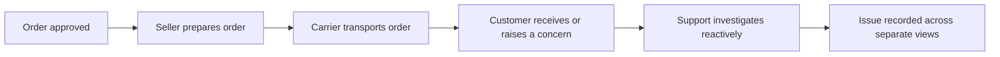
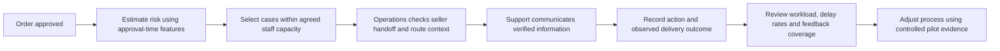

# Business Analyst case study
Historical Brazilian Olist data, 2016–2018 · Portfolio scenario · Prepared 19 November 2026

## Problem, scope and stakeholders
Operations needs to distinguish where late deliveries are concentrated, understand their association with reviews, and prioritise investigation within available staffing. The analysis covers 99,441 historical orders, with commercial KPIs scoped to delivered orders. It does not represent current Australian delivery performance, a live operations queue, profit, or proven intervention benefits.

**Case-study assumptions:** intended stakeholders are an operations manager (delivery investigation), seller support (seller discussions), customer support (communication), and an analyst (metric reconciliation). No stakeholder interviews were conducted. Roles, needs, staffing budgets and the process below are proposed rather than observed.

## Five requirements and acceptance criteria
| ID | Dashboard requirement | Acceptance criteria |
|---|---|---|
| R1 | Operations can see commercial scale and monthly trends | Unfiltered delivered orders = 96,478; merchandise BRL 13,221,498.11; freight BRL 2,198,275.64; AOV BRL 137.04. Values reconcile to SQL; freight remains separate. Date axis includes calendar months; sparse/partial coverage is labelled. |
| R2 | Operations can filter delivery comparisons by month and category | Date/category selections affect all page metrics. Unfiltered eligibility = 96,470; late = 6,534; late rate = 6.77%. Eight delivered orders with missing dates are excluded from this denominator. Empty selections return blanks rather than an invented zero rate. |
| R3 | Seller support can compare sellers without misleading tiny samples | Seller view shows eligible count, late count and rate; rate is blank below 100 eligible orders after filters. The qualifying seller with 389 eligible / 74 late displays 19.02%. Multi-seller order outcomes are labelled as whole-order associations; totals use distinct orders. |
| R4 | Customer support can compare reviews across delivery outcomes | Latest-review rule is documented. Unfiltered on-time mean = 4.29 and late mean = 2.27; low-review rates = 9.27% / 62.40%. Coverage is available, missing reviews remain missing, and association/causality and review-timing limits are visible. |
| R5 | Operations can prioritise problems using both scale and rate | Region view shows SP: 1,820 late / 40,494 eligible, RJ: 1,495 / 12,350. Category view shows counts and rates, including Unknown. Scenario queue reports investigation count, precision, recall and investigations per late order; it is explicitly historical and does not imply current unresolved orders. |

Automated pandas/SQL-export reconciliation supports metric acceptance. Power BI JSON passes public schema checks; Desktop refresh and interactive acceptance checks remain pending and must be recorded before calling the dashboard accepted.

## Proposed current and improved processes
Both maps are **case-study assumptions**.

The improved process adds early triage and a feedback loop; it does not assume that a prediction prevents a delay. Actions require access to operational events absent from this historical dataset.

## Recommendations and decision gates
1. **Investigate RJ routes and promise windows, then BA.** RJ has 1,495 late orders and a 12.11% rate versus 6.77% overall; BA has 396 and 12.16%. Compare matched purchase months and route/seller mix before attributing the problem. SP remains a volume priority despite its 4.49% rate.
2. **Pilot customer communication.** Low-review rates are 62.40% for reviewed late orders versus 9.27% on time. Use a controlled comparison of low reviews, contact workload and review coverage; the association does not prove communication will improve scores.
3. **Pilot capacity-limited risk triage.** The selected model's top 10% test queue finds 124 late deliveries from 1,255 investigations, approximately twice random expectation but only 20.70% recall. Define staff capacity with stakeholders and validate a later cohort before live deployment. Monitor false positives and regional burden.

No cost-benefit ROI is calculated: staffing costs, intervention effectiveness and delay-related financial losses are unknown. Evidence and methods: [analysis](analysis.md), [model audit](model_audit.json), [SQL validation](sql_validation_results.md).
