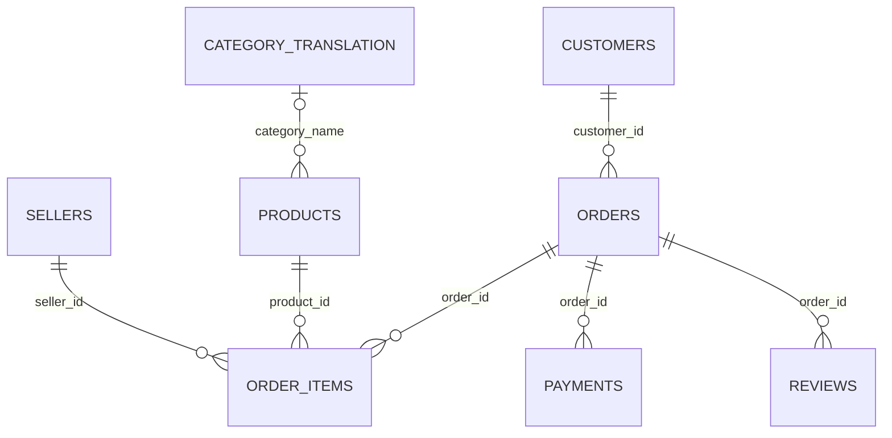

# Data relationships and grain

Raw grain: orders = order; customers = order-specific customer_id; items = order + item sequence; payments = order + payment sequence; reviews = review rows, not necessarily unique order or review ID; products = product; sellers = seller. Translation is optional for a product's category.

Payments, items and reviews are independently aggregated/selected before the SQL order-fact join. Repeat purchases use customer_unique_id. ZIP-prefix geolocation has many coordinate rows and is not joined directly; the baseline model uses states and avoids geolocation inflation.

Power BI: Calendar (1) → Orders (*); Orders (1) → Items (*); Categories (1) → Items (*); Sellers (1) → Items (*). All relationships filter one way. Measures apply distinct visible Items[order_id] to Orders through TREATAS, so category/seller selections affect order outcomes without bidirectional relationship ambiguity. Merchandise sums selected item prices; overlapping category order counts are not additive. Physical item-level attribution remains separate from whole-order delay attribution.
